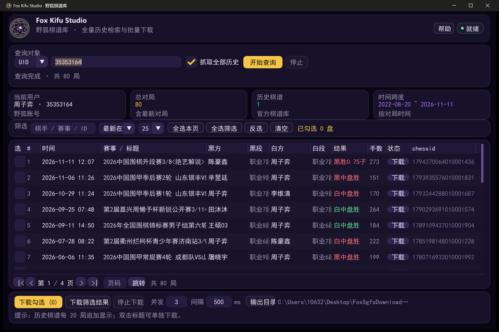
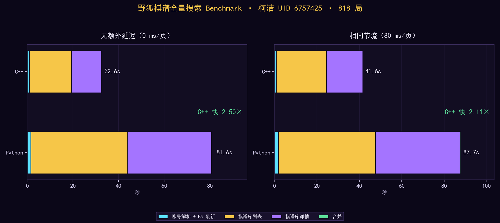

# FoxSgfsDownload · Fox Kifu Studio

野狐围棋棋谱库的**全量历史检索 / 批量下载**工具，C++20 重写版。

> ## ⚠️ 严格绝对禁止商用
> 本项目采用**自定义非商业协议**：任何形式的商业使用（售卖、付费分发、SaaS、广告变现、商业培训、商业数据/AI 训练、企业内部商业使用等）**一律禁止**。  
> 仅限个人学习、复盘、研究使用。完整条款见 [LICENSE](LICENSE)。



## 功能

- **昵称 / UID 查询**
- **官方棋谱库全量历史**：H5 最新约 100 局 + 棋谱库列表 + 详情元数据
- **流式追加**：每 20 局立即进入表格，搜索中也能翻页、筛选、排序
- **树搜索**：读取 `root.txt`，按深度展开对手，每行一个昵称/UID
- **批量下载 SGF**：勾选下载 / 下载筛选结果 / 单局下载
- 关键词筛选、时间排序、分页、跳页、全选/反选
- 并发数、请求间隔、输出目录可调
- 自动跳过已存在的 SGF，下载进度与成功/失败/跳过统计
- SGF 主分支规范化
- 深色魔法阵主题、圆角卡片、金色高亮、流式进度条
- 单文件 exe，静态链接 MSVC 运行库，不依赖 `_internal` 或 VC++ Redistributable

## Benchmark

同一目标（柯洁 UID `6757425`，818 局）、同一网络、同一时间段，Python 版与 C++ 版对比：

| 条件 | Python | C++ | C++ 加速 |
|---|---:|---:|---:|
| 无额外延迟（0 ms/页） | 81.6 s | **32.6 s** | **2.50×** |
| 相同节流（80 ms/页） | 87.7 s | **41.6 s** | **2.11×** |
| 纯合并/解析 | 0.199 s | **0.013 s** | **15.3×** |

完整方法、分阶段数据和原始 JSON/CSV 见 [benchmark/BENCHMARK.md](benchmark/BENCHMARK.md)。



## 构建

### 环境

- Windows 10/11
- Visual Studio 2022 或 2026，安装“使用 C++ 的桌面开发”
- CMake 3.20+

### 一键构建

```bat
build.bat
```

手动构建：

```bat
cmake -S . -B build -G "Visual Studio 18 2026" -A x64
cmake --build build --config Release
```

VS 2022 使用：

```bat
cmake -S . -B build -G "Visual Studio 17 2022" -A x64
cmake --build build --config Release
```

生成：`build\Release\FoxKifuStudio.exe`；`build.bat` 会同时复制到 `release\`。

## 使用

双击 `release\FoxKifuStudio.exe`，或运行 `run.bat`。

1. 选择“昵称”或“UID”。
2. 输入查询对象，勾选“抓取全部历史”。
3. 查询开始后，最新约 100 局先出现，随后棋谱库每 20 局追加一页。
4. 搜索完成后自动补全双方段位、胜负、手数。
5. 勾选对局，点击“下载勾选”或“下载筛选结果”。

输出目录默认是 exe 同级的 `downloads`，可在底部“输出目录”里修改。

### 树搜索

把要展开的棋手写进 exe 同目录的 `root.txt`：

```text
柯洁
6757425
# 以 # 开头的行会被忽略
```

查询方式选“树搜索”，深度 1 只查 root.txt 里的人，深度 2 会继续查他们的对手。

### 命令行参数

```bat
FoxKifuStudio.exe --query 柯洁
FoxKifuStudio.exe --query 6757425 --uid
FoxKifuStudio.exe --query 6757425 --uid --download
FoxKifuStudio.exe --tree
```

- `--query`：昵称或 UID
- `--uid`：按 UID 查询
- `--tree`：从 root.txt 启动树搜索
- `--download`：查询结束后自动下载全部筛选结果

## 项目结构

```text
.
├─ assets/
│  ├─ app.rc
│  └─ magic_circle.ico
├─ benchmark/                 # Python vs C++ benchmark
├─ src/
│  ├─ main.cpp                # Win32 + D3D11 + Dear ImGui 界面、搜索/下载调度
│  ├─ fox.cpp / fox.h         # FoxWQ 接口、HTML/JSON/棋谱库解析、SGF
│  ├─ http.cpp / http.h       # WinHTTP 封装
│  ├─ model.h                 # Game / UserInfo
│  ├─ util.cpp / util.h       # UTF-8、URL、HTML、SGF 规范化
│  └─ bench.cpp               # C++ 核心 benchmark
├─ third_party/
│  ├─ imgui/                  # Dear ImGui 1.91.9b + Win32/DX11 后端
│  └─ nlohmann/               # json.hpp
├─ CMakeLists.txt
├─ build.bat / run.bat
├─ root.txt
├─ preview.png
└─ LICENSE
```

## 数据来源与限制

- H5 `YHWQFetchChessList` 只返回最新约 100 局，且 `lastcode` 游标已失效。
- 全量历史来自官方棋谱库：
  - `https://www.foxwq.com/qipu.html?keyword=...&p=...`
  - `https://www.foxwq.com/newqipu/requestQp?...`
- 纯日常对局中，超过最新 100 局且未被棋谱库收录的部分，官方没有公开分页接口，仍无法获取。
- 匿名公开接口访问，不需要登录；请控制并发和间隔，避免给对方服务器造成压力。

## 授权协议

**严格绝对禁止商用。**

本项目采用自定义非商业协议，核心条款：

- 仅允许个人学习、复盘、研究等**非商业用途**。
- 禁止售卖、付费分发、捆绑销售、SaaS、广告变现、商业培训、商业数据/AI 训练、企业内部商业使用等任何直接或间接商业目的。
- 下载的 SGF 版权归原作者及野狐平台所有，不得二次分发或商用。
- 不得移除版权与协议声明；修改版必须保留本协议并注明修改。
- 禁止绕过限流、攻击接口、批量爬取或违反野狐用户协议。
- 软件按“现状”提供，不提供任何担保；使用风险由使用者承担。

完整条款以 [LICENSE](LICENSE) 为准。若需商用，必须事先取得作者书面授权。

## 免责声明

- 本项目与腾讯、野狐围棋官方无任何关联。
- 仅用于个人学习与复盘，请遵守野狐用户协议及当地法律法规。
- 因使用本工具导致的账号限制、IP 封禁、数据丢失或其它损失，作者不承担责任。

## 第三方组件

- [Dear ImGui](https://github.com/ocornut/imgui) — MIT License
- [nlohmann/json](https://github.com/nlohmann/json) — MIT License

详见 [THIRD_PARTY_NOTICES.md](THIRD_PARTY_NOTICES.md)。

## 说明

exe 未购买代码签名证书，首次运行可能出现 SmartScreen 提示，点“更多信息 → 仍要运行”即可；也可以右键 exe → 属性 → 解除锁定。
