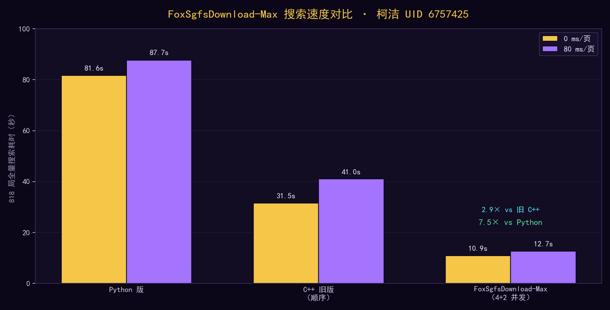

# FoxSgfsDownload-Max 搜索速度 Benchmark



## 测试条件

- 机器：Intel Core Ultra 5 125H，Windows 10 Home China（10.0.26300）
- 目标：柯洁，UID `6757425`
- 搜索内容：H5 最新 101 局 + 官方棋谱库列表 **41 页** + 棋谱库详情 **39 页**
- 最终结果：**818 局**，两边返回的 `101 / 717 / 1153 / 818` 计数一致
- 同一网络、同一时间段；每种模式跑 3 次，取中位数
- 只测搜索核心，不包含 GUI 绘制

## Max 的并行方式

- H5 最新和账号解析仍然串行，只占约 0.7–0.8 秒。
- 棋谱库列表：**4 个 worker 并发翻页**。列表页之间没有游标依赖，可以直接按页码并行。
- 棋谱库详情：`type=1` 和 `type=6` 各一条串行游标链，**两条链并发**。
- 列表页和详情页同时开始，因此 `search_ms` 和 `meta_ms` 是重叠的，不能直接相加。

## 结果

| 条件 | Python 版 | C++ 旧版（顺序） | **FoxSgfsDownload-Max** | Max vs Python | Max vs 旧 C++ |
|---|---:|---:|---:|---:|---:|
| 无额外延迟（0 ms/页） | 81.6 s | 31.5 s | **10.9 s** | **7.47×** | **2.88×** |
| 相同 80 ms/页节流 | 87.7 s | 41.0 s | **12.7 s** | **6.90×** | **3.22×** |

### 三次原始总耗时

- Python 0 ms：59.0 / 92.1 / 81.6 s（中位数 81.6 s）
- Python 80 ms：87.6 / 87.9 s（中位数 87.7 s）
- C++ 旧版 0 ms：31.5 / 30.7 / 33.5 s（中位数 31.5 s）
- C++ 旧版 80 ms：41.7 / 41.0 / 40.5 s（中位数 41.0 s）
- **Max 0 ms：9.21 / 10.93 / 11.43 s（中位数 10.93 s）**
- **Max 80 ms：12.85 / 12.60 / 12.73 s（中位数 12.73 s）**

## 分阶段耗时

| 模式 | 列表搜索 | 详情补全 | 总耗时 |
|---|---:|---:|---:|
| 旧版顺序 0 ms | 18.0 s | 12.8 s | 31.5 s |
| Max 并发 0 ms | 10.1 s | 10.1 s（与列表重叠） | **10.9 s** |
| 旧版顺序 80 ms | 22.3 s | 17.4 s | 41.0 s |
| Max 并发 80 ms | 12.0 s | 12.0 s（与列表重叠） | **12.7 s** |

## 结论

- 相比旧 C++ 顺序搜索：**约 2.9×（0 ms）到 3.2×（80 ms）**。
- 相比 Python 版：**约 6.9×–7.5×**。
- 主要收益来自把 41 页列表请求分散到 4 个 worker，同时让 39 页详情请求与列表请求并行；合并、解析仍然只占毫秒级。
- 继续加 worker 到 6 个并没有更快（实测反而略慢），说明 4 个列表 worker + 2 条详情链已经接近当前接口的并发上限。

## 复现

```bat
:: 旧版顺序基线
FoxSgfsDownloadMaxBench.exe --runs 3 --delay 0

:: Max 并发
FoxSgfsDownloadMaxBench.exe --parallel --workers 4 --runs 3 --delay 0

:: 相同 80 ms/页节流
FoxSgfsDownloadMaxBench.exe --runs 3 --delay 80
FoxSgfsDownloadMaxBench.exe --parallel --workers 4 --runs 3 --delay 80
```

原始数据：

- [max_sequential.jsonl](max_sequential.jsonl)
- [max_parallel.jsonl](max_parallel.jsonl)
- [max_sequential_80.jsonl](max_sequential_80.jsonl)
- [max_parallel_80.jsonl](max_parallel_80.jsonl)
- [results_max.csv](results_max.csv)

说明：Python 版的搜索实现已经从本项目中清理，Python 数据是清理前在同一台机器、同一目标下测得并保留的对照结果。
